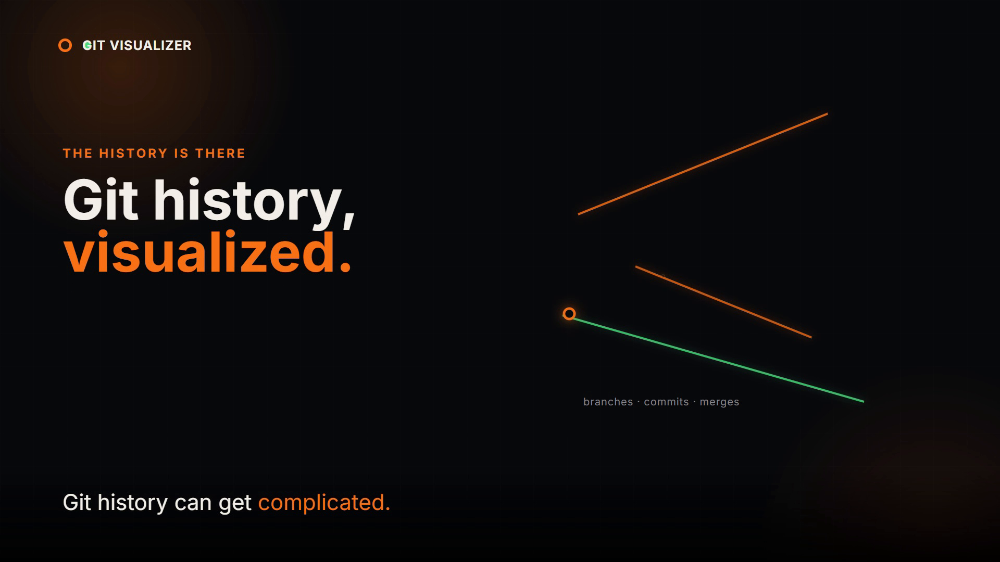

# Git Visualizer

> See the story behind every commit.

Git Visualizer is an interactive Git learning platform that turns repository state into a live, explorable visual model. Inspect commit history, simulate Git commands, follow branches and merges, compare undo strategies, and learn how Git moves changes between its core areas, all in the browser.

<p align="center">
  <a href="https://git-visualizer.dipeshsapkota7.com.np/">Open Git Visualizer</a>
  &nbsp;&middot;&nbsp;
  <a href="https://github.com/dszae/git-visualizer">View source</a>
</p>

## Product Launch

<p align="center">
  <video src="./git-visualizer-video-output/git-visualizer-launch.mp4" autoplay loop controls muted playsinline width="100%">
    <a href="./git-visualizer-video-output/git-visualizer-launch.mp4">Watch the Git Visualizer launch video</a>
  </video>
</p>

<p align="center">
  <a href="./git-visualizer-video-output/git-visualizer-launch.mp4">
    
  </a>
</p>

The launch video is available in both formats:

- [16:9 launch video](git-visualizer-video-output/git-visualizer-launch.mp4)
- [9:16 vertical reel](git-visualizer-video-output/git-visualizer-reel.mp4)

## Why It Exists

Git is powerful, but its mental model is easy to lose inside terminal output alone. Git Visualizer makes that model visible and gives learners a safe place to experiment with realistic repository state.

The simulator runs entirely in the browser. Repository state is deterministic and in-memory, so commands can be explored without touching a real checkout or sending repository data to an external server.

## What You Can Explore

### Live commit graph

- Topological SVG layout for linear history, diverging branches, rebases, and multi-parent merges.
- Branch pointers, `HEAD`, tags, remote-tracking labels, and detached `HEAD` states.
- Clickable commits with hashes, authors, dates, messages, parent links, and file snapshots.
- Pan, zoom, fit-to-view, and an accessible table representation for keyboard and screen-reader users.

### Deterministic Git simulator

The engine models the Working Directory, Staging Area, Local Repository, Remote Repository, tracking branches, `HEAD`, tags, stashes, reflog entries, and merge-conflict state.

Supported command families include:

```text
init  status  add  commit  log  diff  branch  switch  checkout
merge  rebase  stash  fetch  pull  push  clone  remote  tag  show
restore  reset  revert  cherry-pick  reflog
```

Commands are parsed, validated, executed against immutable-style state transitions, and reflected immediately in the graph and inspection panels.

### Interactive command console

- Git command input with syntax-aware suggestions and tab completion.
- One-click actions for staging, committing, branching, switching, merging, and status checks.
- ANSI-aware terminal output with command history and Up/Down navigation.
- Before/after explanations showing what changed, what stayed intact, the resulting state, and suggested next steps.
- Timeline playback for stepping through repository history.

### Learning tools

- Twelve guided lessons from repository initialization through reflog recovery.
- Target challenges with branch, commit, and file-state validation.
- Safe Undo Lab comparing `restore`, `reset`, `revert`, and `reflog` across the Working Directory, Index, branch tips, and history.
- Five-stage architecture flowchart covering Stash, Workspace, Staging, Local Repository, and Remote Repository.
- Searchable command reference with syntax, preconditions, effects, common errors, and sandbox execution.

### Shareable scenarios

Repository states can be encoded into URL parameters, making a scenario easy to share or reopen:

```text
?state=<serialized-repository-state>
?scenario=<preset-scenario-id>
```

## Architecture

```text
React UI
  -> deterministic Git engine
  -> repository state, history, explanations, and terminal output
  -> SVG graph, timeline, lessons, undo lab, flowchart, and reference views
```

The application is organized around a small set of focused surfaces:

- `src/engine/` contains repository state transitions and preset scenarios.
- `src/components/graph/` renders the commit DAG and commit inspection experience.
- `src/components/workspace/` owns the command console, terminal logs, and timeline controls.
- `src/components/lessons/`, `src/components/undoLab/`, `src/components/flowchart/`, and `src/components/reference/` provide the learning views.
- `tests/` covers Git engine behavior, including staging, commits, branches, merges, conflicts, undo operations, remotes, and recovery.

## Tech Stack

- React 19
- Vite 8
- Tailwind CSS
- Vitest
- oxlint
- Vercel deployment

## Getting Started

### Requirements

- Node.js 18 or newer
- npm

### Install and run

```bash
git clone https://github.com/dszae/git-visualizer.git
cd git-visualizer
npm install
npm run dev
```

Open the local Vite URL printed in the terminal.

### Verify the project

```bash
npm test
npm run lint
npm run build
```

## Live Demo

Visit [git-visualizer.dipeshsapkota7.com.np](https://git-visualizer.dipeshsapkota7.com.np/) to start in the interactive sandbox.

## Author

**Dipesh Sapkota**

- Website: [dipeshsapkota7.com.np](https://www.dipeshsapkota7.com.np/)
- GitHub: [@Dszae](https://github.com/Dszae)
- Project: [Git Visualizer](https://git-visualizer.dipeshsapkota7.com.np/)

## License

See the repository for the current license and project metadata.
